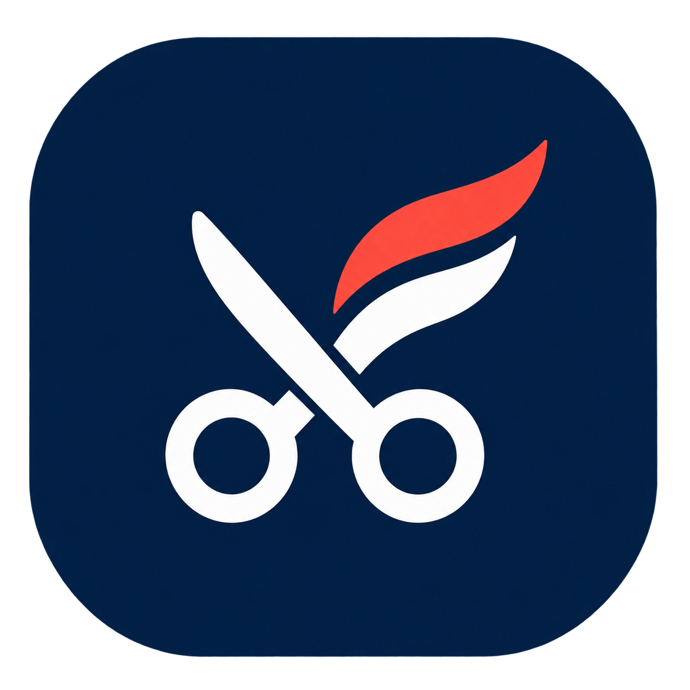

# Frizeraj



Sistem za red čekanja u frizerskim salonima, bez zakazivanja termina. Klijenti preko mobilne aplikacije pregledaju salone, biraju uslugu i prijavljuju se u red. Osoblje prati prijave, upravlja dostupnošću frizera i beleži početak i završetak usluge.

Projekat iz predmeta Razvoj multiplatformskih aplikacija, tim 25.

## Tim

| Ime i prezime | Broj indeksa | GitHub nalog |
| --- | --- | --- |
| Boris Bošković | SI 114/24 | [@CoolGitGuy](https://github.com/CoolGitGuy) |
| Filip Karadžić | SI 131/24 | [@StaticVoid-0](https://github.com/StaticVoid-0) |

## Zahtevi za temu

Glavni pojam sistema je **prijava u red** za određeni salon i uslugu.

1. **Uloge.** Klijent pregleda salone, prijavljuje se u red i otkazuje svoju prijavu dok čeka. Osoblje upravlja dostupnošću frizera, početkom i završetkom usluge i nedolaskom klijenata.
2. **Stanja.** Prijava može biti na čekanju, pozvana, u toku, završena, otkazana ili označena kao nedolazak. Zajednički domen određuje dozvoljene prelaze između stanja.
3. **Pravila.** Klijent može imati najviše jednu aktivnu prijavu po salonu, prijavljivanje je dozvoljeno tokom radnog vremena, a napomena ima najviše 120 znakova. Automatska dodela bira najranijeg klijenta čiju uslugu slobodan frizer pruža, pa zavisi od drugih prijava i zauzetosti frizera; u serverskoj fazi konačnu proveru obavljaće server.
4. **Rad bez mreže.** U KT3 planirano je lokalno čuvanje zahteva za otkazivanje i slanje po povratku mreže. Server će proveriti aktuelno stanje i moći da odbije otkazivanje ako je klijent u međuvremenu pozvan.
5. **Posao za osoblje.** Backoffice prikazuje prijave, statuse, detalje i dostupnost frizera na većem ekranu. Osoblje koristi tastaturu i akcije za obradu reda, dok uži prozor prikazuje listu uz očuvan izbor prijave.
6. **Javni sadržaj.** U KT4 planiran je javni veb sa salonima, uslugama, cenama, radnim vremenom i stanjem reda bez ličnih podataka klijenata. Taj sadržaj dostupan je i bez naloga i ima smisla za indeksiranje u pretraživačima.

## Delovi sistema

| Deo | Korisnici | Tehnologija | Platforme |
| --- | --- | --- | --- |
| Mobilna aplikacija | klijenti | Flutter | Android |
| Backoffice | osoblje salona | Flutter | Windows, veb |
| Domenski paket | oba klijenta | Dart | nezavisan od platforme |

Oba klijenta koriste isti domenski paket i Bloc. Svaki ima svoju implementaciju repozitorijuma sa nezavisnim podacima u memoriji; server i sinhronizacija između klijenata dolaze u narednim kontrolnim tačkama.

## Pokretanje

Provereno sa Flutter 3.47.7 i Dart 3.13.5. Za Android su potrebni Android SDK i emulator ili povezan uređaj; za Windows Visual Studio sa opcijom **Desktop development with C++**, a za veb Chrome ili Edge.

Sve aplikacije i paketi pripadaju jednom pub workspace-u. Zavisnosti se preuzimaju iz korena projekta:

```powershell
flutter pub get
flutter devices
```

Mobilna aplikacija, iz korena projekta, uz pokrenut Android emulator ili povezan telefon:

```powershell
cd apps/mobile
flutter run -d <id-android-uredjaja>
```

Backoffice za Windows, iz zasebnog terminala u korenu projekta:

```powershell
cd apps/backoffice
flutter run -d windows
```

Za veb, iz foldera `apps/backoffice`:

```powershell
flutter run -d chrome
```

ID Android uređaja prikazuje komanda `flutter devices`.

Podaci su demo podaci u memoriji. Mobilna aplikacija koristi fiksnog klijenta Borisa, a backoffice fiksnog člana osoblja. Početni skup ima 17 prijava, od kojih 12 pripada Borisu, kroz svih šest stanja. Restart aplikacije vraća početne podatke; obično osvežavanje čuva promene.

Za ponovljivo ponašanje demo sat je postavljen na **31.10.2026. u 12:00**, tokom radnog vremena salona. Zahtevi imaju kašnjenje od 550 ms. Meni **Demo kontrole** omogućava grešku narednog zahteva ili jednokratni prazan odgovor, za prikaz učitavanja, greške sa ponovnim pokušajem, praznog prikaza i podataka. U mobilnoj aplikaciji kontrole su dostupne na Profilu i ekranima sa zajedničkom gornjom trakom.

## Struktura

```text
apps/mobile          mobilni klijent: saloni, forma, moje prijave i detalj
apps/backoffice      osoblje: tabela/lista, detalj i dostupnost frizera
packages/domain      modeli, ID tipovi, stanja, pravila i port repozitorijuma
packages/use_cases   memorijski adapter, početni podaci i demo sat
packages/blocs       zajednički QueueBloc, događaji i stanje
packages/ui          tema, ikonice, poruke, splash i zajednički widgeti
```

Paketi `domain`, `use_cases` i `blocs` su čisti Dart, bez Flutter i platformskih zavisnosti. `blocs` i `use_cases` zavise od domena; aplikacije povezuju repozitorijume, Bloc i interfejs. Ekrani šalju događaje, a validacija i dozvoljene promene stanja nalaze se u domenu.

## Provere

Iz korena projekta:

```powershell
flutter analyze
flutter test packages/domain/test packages/use_cases/test packages/blocs/test packages/ui/test apps/mobile/test apps/backoffice/test tools/kt1_acceptance_test.dart
```

Testovi pokrivaju pravila prijavljivanja i promene statusa, kompatibilnu dodelu frizera, konflikte, stanja učitavanja, forme, potvrde akcija, zamenu repozitorijuma, tastaturu i promenu širine prozora.

## Stanje projekta

**KT1 — dva klijenta nad istim domenom.** Mobilna aplikacija i backoffice rade sa zajedničkim modelima, pravilima i Bloc-om, uz podatke u memoriji. Prijava prelazi iz čekanja u pozvanu, zatim u uslugu u toku i završenu; podržani su i otkazivanje i nedolazak, uz tipizovane domenske greške i poruke na srpskom.

Backoffice podržava izbor strelicama, `Ctrl+Enter` za početak/završetak usluge, `Ctrl+R` za osvežavanje i `Esc` za zatvaranje detalja. Sužavanje prozora menja tabelu u listu uz očuvan izbor. Server, autentifikacija, rad bez mreže i javni veb planirani su za naredne kontrolne tačke.
