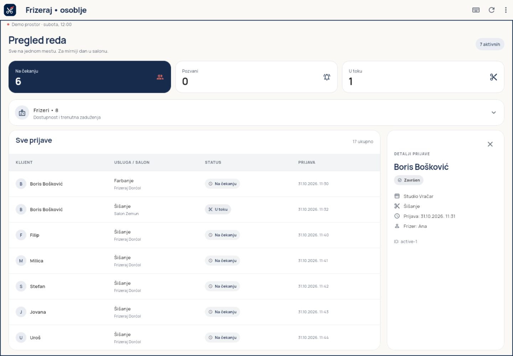

# Frizeraj KT1 provera prema originalnoj specifikaciji

Provera je započeta 3. novembra, a završena 4. novembra 2026. Funkcionalni
zahtevi četiri KT1 oblasti postoje i automatske provere prolaze. Predaja još
nije potvrđena: ovaj folder nema Git repozitorijum. Windows desktop je u
dodatnom prolazu uspešno pokrenut i proveren; prvobitna OS blokada se nije ponovila.

## Izvori i značenje rezultata

Pročitani su originalni dokumenti iz korisnikovog Downloads foldera:

- `KT1 - Dva klijenta nad istim domenom.docx` — kriterijumi četiri oblasti,
  predaja, čist klon i odbrana.
- `Projektni zadatak - Razvoj multiplatformskih aplikacija.docx` — šest zahteva
  teme, javni timski repozitorijum u organizaciji predmeta i uslov prihvaćene teme.

Sadržaj je pročitan iz DOCX dokumenta, uključujući pasuse i tabele; ovo nije
procena prema ranijem prepričavanju. Tema je prihvaćena prema Borisovoj potvrdi
tokom ove provere. Status tabele nastavnika nije nezavisno proveravan.

„Prošlo” znači da postoje implementacija i odgovarajuća izvršena provera.
Ljudska odbrana, znanje oba člana i objava na GitHub-u nisu zamenjeni testovima.

## Zbir izvršenih provera

| Provera | Rezultat |
| --- | --- |
| Root `flutter pub get` | Prošlo |
| `flutter analyze` | Bez problema |
| Svi testovi sa render alatom i dodatnim KT1 proverama | **42 prošla**: 41 funkcionalni test i jedan render scenario |
| Android `flutter build apk --debug` | Prošlo |
| Windows `flutter build windows` | Prošao release build |
| Windows `flutter run -d windows` | Prošlo u dodatnom prolazu; stvarni native prozor pokrenut |
| Backoffice `flutter build web` | Prošlo, uključujući Wasm dry run |
| Stvarni web prikaz i akcije | Prošlo u lokalnom Chromium pregledaču |
| Android aplikacija na emulatoru | Pokrenuta i vizuelno potvrđena aktivna sesija |
| Kopija bez starih buildova i lokalnih SDK putanja | `pub get`, analiza i 35 postojećih funkcionalnih testova prošli |
| Jedna izmena domena vidljiva u oba klijenta | Dve dodatne provere prošle u izolovanoj kopiji |
| Stvarni Git klon i GitHub `main` | Nije moguće potvrditi: folder nema `.git` |

## 1 Mobilna aplikacija

| Kriterijum iz KT1 | Dokaz | Rezultat |
| --- | --- | --- |
| Android ili iOS, fiksni korisnik | Android build i emulator; `demoClient` je Boris | Prošlo; iOS nije potreban uz Android |
| Najmanje deset zapisa, sva stanja | Seed ima 12 Borisovih i ukupno 17 prijava; test proverava svih šest statusa | Prošlo |
| Pregled i poseban detalj glavnog pojma | `MyEntriesScreen`, `QueueEntryDetailScreen`, ruta sa ID-em i widget test | Prošlo |
| Kreiranje ili promena stanja | Forma šalje `JoinQueue`; detalj šalje otkazivanje | Prošlo |
| Potvrda nepovratne akcije | Test otvara dijalog otkazivanja, odustaje, pa potvrđuje | Prošlo |
| Forma sa domenskim pravilom i srpskom porukom | `validateNote`, granica 120 znakova, test preduge napomene i uspešne prijave | Prošlo |
| Adresa po ekranu, tema i ikonica | `go_router` sa rutama po ID-u, zajednička tema/Manrope i Android resursi ikonice | Prošlo pregledom koda, buildom i prikazom |
| Ceo tok i mala izmena uživo na odbrani | Tok pokriven widget testovima i aplikacija radi na Androidu | Demonstracija i samostalna izmena oba člana ostaju za odbranu |

Dokazi: `apps/mobile/test/widget_test.dart`, `home_screen_test.dart`,
`packages/use_cases/test/use_cases_test.dart` i
[snimak aktivne Android sesije](previews/kt1-android-provera.png).
Aktivna sesija može imati dodatne prijave; početni seed je proveren zasebno.

## 2 Domenski paket

| Kriterijum iz KT1 | Dokaz | Rezultat |
| --- | --- | --- |
| Root workspace, čist Dart domen, oba klijenta ga koriste | Workspace manifest, importi i zavisnosti; nema zabranjenih Flutter/IO/FFI/JS interop importa u domenu | Prošlo |
| Modeli sa final poljima i posebni ID tipovi | `models.dart`, `identifiers.dart`; kolekcije imaju nepromenljive kopije | Prošlo |
| Najmanje četiri stanja i eksplicitni prelazi | Enum ima šest statusa; `canTransition`; test cele matrice prelaza | Prošlo |
| Bar dva pravila sa tipizovanim uspehom/greškom | `validateNote`, `validateJoinQueue`, `validateTransition`, `Result`/`DomainError` | Prošlo |
| Pravilo koje zavisi od drugih korisnika | `assignAvailableBarbers` proverava zauzetost i bira najranijeg kompatibilnog klijenta iz celog reda | Prošlo; domen testira zauzetost i zaštitu od dvostruke dodele |
| UI koristi pravila iz domena | Forma koristi `validateNote`, oba detalja `validateTransition`; repo ponavlja konačnu proveru | Prošlo |
| Promena pravila utiče na oba klijenta | U izolovanoj kopiji uklonjen je prelaz waiting → cancelled; dugme nestaje iz oba detalja | Dve provere prošle; pravilo vraćeno i hash izjednačen sa radnim projektom |

Zaštita konkurentnosti odnosi se na memorijsku instancu KT1 procesa. Testovi
paralelnih prijava i revizija prolaze; to nije dokaz buduće transakcione zaštite
između uređaja, koja pripada serveru u KT2.

## 3 Upravljanje stanjem i repozitorijumi

| Kriterijum iz KT1 | Dokaz | Rezultat |
| --- | --- | --- |
| Čist Dart paket sa pravim Bloc-om | `QueueBloc extends Bloc<QueueEvent, QueueState>`; odvojeni events/states; bez Flutter importa | Prošlo |
| Učitavanje i akcija promene | `LoadQueue`, `JoinQueue`, `ChangeEntry`, `ChangeAvailability` | Prošlo |
| Jednakost stanja po vrednosti | `QueueState extends Equatable`; zaseban test jednakosti | Prošlo |
| Port i fake implementacija | `abstract interface class QueueRepository` u domenu; fake klase u obe aplikacije | Prošlo |
| Memorija, kašnjenje i simulirana greška | `MemoryQueueStore`, 550 ms, `failNextRequest`, demo meni | Prošlo |
| Loading, error sa retry, empty, data | Widget testovi oba klijenta; dodatno stvarni web prolaz kroz sva četiri prikaza | Prošlo |
| Ekrani šalju događaje i prikazuju stanje | BlocBuilder/BlocConsumer, zajednički domen, prezentacioni widgeti | Prošlo pregledom i izvršenim tokovima |
| Zamena implementacije bez izmene ekrana | `ReplacementRepository implements QueueRepository`, prosleđen konstruktorima obe aplikacije | Dva acceptance testa prošla |

Prazni podaci su uspešno stanje sa praznom listom; specifikacija ne zahteva
posebnu klasu `Empty`. Home ocene/udaljenosti/ETA su demo prezentacioni podaci,
odvojeni od poslovnog pravila raspodele reda.

## 4 Backoffice

| Kriterijum iz KT1 | Dokaz | Rezultat |
| --- | --- | --- |
| Windows i web nad istim domain/blocs paketima | Oba builda i oba stvarna prikaza rade iz iste backoffice aplikacije | Prošlo |
| Više zapisa i bočni detalj | Široka tabela sa 17 prijava, desni panel; screenshot stvarnog web prikaza | Prošlo |
| Bar dve akcije osoblja | Početak i završetak; dostupnost i nedolazak takođe postoje | Prošlo testovima, web prečicom i Windows dugmadima |
| Potvrda nedolaska | Acceptance test prvo odustaje, zatim potvrđuje; proverava stanje u repou | Prošlo |
| Kretanje, dve prečice i vidljiv fokus | Strelice/Enter, Ctrl+R, Ctrl+Enter, Esc; Focus okvir i tematski fokus kontrola | Prošlo widget testovima i web tastaturom |
| Lista ispod granice širine bez gubitka izbora | Stvarni web prelaz 1440 × 1000 → 600 × 1000; izabrana prijava ostaje ista | Prošlo |
| Isti tok u pregledaču | Početak/završetak, osvežavanje, greška/retry, empty/povratak podataka | Prošlo |
| Stvarna desktop demonstracija | Native Windows prozor, strelice, početak/završetak i sužavanje uz očuvan izbor | Prošlo; Boris je fizičkom tastaturom potvrdio Ctrl+Enter za početak i Ctrl+R |

Web provera je izvršena nad lokalnim release buildom na `127.0.0.1:5173`.
Prijava `active-1` je prošla called → inProgress → completed. Ctrl+R je sačuvao
izmenu, a posle sužavanja ostao je izabran isti ID. Greška i jednokratni prazan
odgovor nisu obrisali memorijske podatke.



Dodatna Windows provera: prijava `active-1` prošla je called → inProgress →
completed preko dugmadi. Strelice menjaju izabranu prijavu; sužavanje prozora
na 768 px prebacilo je tabelu u listu i sačuvalo izbor. Sačuvani su
[široki prikaz](previews/kt1-windows-provera.png) i
[uski prikaz](previews/kt1-windows-uski.png). Redosled demonstracije je u
[Windows uputstvu](windows-demonstracija.md).

Automatizovani unos Ctrl+Enter na native prozoru nije pouzdano preneo držanje
Ctrl tastera do Enter događaja. Boris je zatim fizičkom tastaturom potvrdio
Ctrl+Enter: pozvana prijava prešla je u „U toku”. Potvrdio je i da Ctrl+R radi,
uz već uspešne widget testove i stvarni web prolaz. Privremeni dijagnostički
ispis je uklonjen.
Početni pokušaj pokretanja bio je blokiran Application Control politikom;
kasnije standardno pokretanje uspelo je bez promene bezbednosnih postavki.
Uzrok promene odluke politike nije utvrđen.

## Kopija bez generisanih fajlova

Izvoz izvornog projekta nalazi se lokalno u `.dart_tool/kt1-audit/clean-source`.
Izostavljeni su buildovi, `.dart_tool`, IDE konfiguracija, Gradle keš,
`local.properties`, ephemeral direktorijumi i generisani plugin registranti.
Root `flutter pub get`, analiza i svih 35 dotadašnjih funkcionalnih testova
prošli su u toj kopiji. Ovo proverava značajan deo ponovljivosti, ali nije
stvarni Git klon niti dokaz da su svi fajlovi poslati na GitHub.

Izmena domenskog pravila rađena je samo u toj izolovanoj kopiji. Dva testa
sa očekivanjem da je otkazivanje zabranjeno su prošla, pa je izvorno pravilo
vraćeno. Radni kod aplikacije nije prepravljan radi ove demonstracije.

## Šta je dopunjeno tokom provere

- Dodato je šest ciljanih provera u `tools/kt1_acceptance_test.dart`.
- README sada eksplicitno obrazlaže svih šest zahteva teme, uz označavanje
  offline rada i javnog SEO sadržaja kao kasnijih KT3/KT4 faza.
- U README je uneta korisnikova potvrda prihvatanja teme i ažurirani su izvori.
- Sačuvani su snimci stvarnog web i Android prikaza.
- Nisu menjana poslovna pravila radne aplikacije.

## Preostalo pre predaje i odbrane

1. **GitHub:** proveriti javni timski repozitorijum u organizaciji predmeta,
   poslati izvore i lockfile na `main` pre 4.11.2026. u 23:59:59. Ovaj radni
   folder nema `.git`, pa push, commit i stanje udaljenog `main` nisu potvrđeni.
2. **Čist klon:** kada GitHub bude spreman, klonirati u novi folder i ponoviti
   dokumentovano pokretanje oba klijenta. Kopija bez keševa nije zamena za taj dokaz.
3. **Odbrana:** oba člana treba samostalno da pokažu tok, objasne kod i naprave
   malu UI/domensku izmenu. Testovi i buildovi ne daju automatski bodove.

Prihvatanje teme je potvrđeno korisnikovim odgovorom. Treba da odgovara stanju
u zvaničnoj tabeli, uključujući eventualni komentar nastavnika.

## Ponovljivo pokretanje provera

Iz root-a:

```powershell
flutter pub get
flutter analyze
flutter test packages/domain/test packages/use_cases/test packages/blocs/test packages/ui/test apps/mobile/test apps/backoffice/test tools/preview_ui_test.dart tools/kt1_acceptance_test.dart
```

Iz foldera backoffice aplikacije:

```powershell
flutter build windows
flutter build web
flutter run -d windows
```

Iz foldera mobilne aplikacije:

```powershell
flutter build apk --debug
flutter run -d emulator-5554
```

Za prikaz već izgrađenog weba koristi `node tools/serve_web.mjs` iz root-a.
ID Android uređaja proveri komandom `flutter devices`.

Web build je prijavio upozorenje o opcionom Cupertino fontu. Kompilacija i
provereni prikaz rade; u našem kodu nema CupertinoIcons upotrebe. Preuzimanje
novijih verzija paketa nije bilo deo ove provere.
